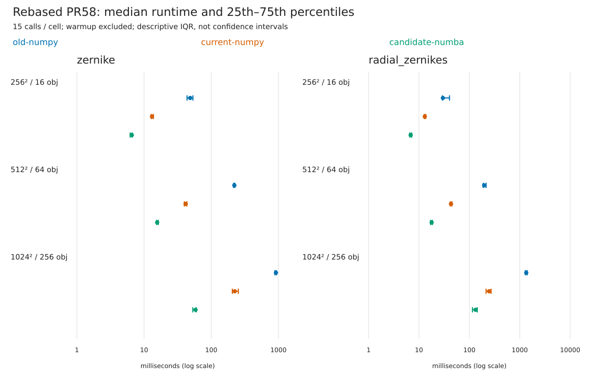

# Rebased PR58 benchmark

Revalidated on 2026-10-20 against current main `c698d44` (after PR115), on an AMD EPYC 9684X.

Milliseconds: median [p25, p75]; 15 timed calls per cell, warmup/JIT excluded.

| Scene | Feature | v0.1.19 NumPy | Current-main NumPy | Rebased Numba | Old/Numba | Current/Numba |
|---|---|---:|---:|---:|---:|---:|
| 256² / 16 | zernike | 48.55 [43.59, 53.28] | 13.11 [12.77, 13.75] | 6.57 [6.21, 6.67] | 7.40× | 2.00× |
| 256² / 16 | radial_zernikes | 29.81 [29.23, 40.32] | 13.04 [12.70, 13.59] | 6.84 [6.57, 7.18] | 4.36× | 1.91× |
| 512² / 64 | zernike | 220.62 [214.87, 224.00] | 41.57 [39.69, 43.39] | 15.65 [15.36, 16.25] | 14.09× | 2.66× |
| 512² / 64 | radial_zernikes | 196.16 [188.55, 215.05] | 43.19 [41.61, 45.20] | 17.82 [17.00, 18.46] | 11.01× | 2.42× |
| 1024² / 256 | zernike | 917.62 [885.66, 930.65] | 224.03 [205.80, 252.99] | 58.41 [53.08, 59.67] | 15.71× | 3.84× |
| 1024² / 256 | radial_zernikes | 1346.43 [1292.35, 1400.61] | 245.60 [214.22, 269.79] | 132.68 [115.12, 143.47] | 10.15× | 1.85× |

## Method and limits

- Source revisions: `{'old-numpy': '54e5c094e4a2c9079f747bdc419eb5623ad2d4d6', 'current-numpy': 'c698d440e6b669222efdf0d128dad88843bf2677', 'candidate-numba': 'fb2549ce8293bf738b734a0cc9fc153c83cacf33'}`.
- Python: 3.11.13; dependencies: `{'centrosome': '1.3.4', 'llvmlite': '0.47.0', 'mahotas': '1.4.18', 'numba': '0.65.1', 'numpy': '1.26.4', 'scikit-image': '0.26.0', 'scipy': '1.16.2'}`.
- CPU 86, all thread limits = 1; one host/core for all sizes and revisions.
- Three rotated sequential process rounds × five calls; one excluded warmup per case/process. Public bulk registry defaults, degree 9.
- Same seed (20261020), inputs, float64 pixels, int32 masks and density as the previous comparison. All variants freshly rerun; no timing ratios across different sessions.
- Input hashes, key order, shapes, dtypes, nonfinite patterns and numerical tolerance checked against current NumPy in every round. Inputs unchanged.
- IQR describes timing variability, not confidence. Speedup ranges are across workload conditions; ratios have no inferred confidence interval.
- Largest round-median max/min ratio: 1.469; CPU affinity does not reserve a shared host.
- Function timings only: no end-to-end pipeline, cold-start or memory claim. Historical comparison combines version and backend improvements.
- Radial azimuthal powers remain in NumPy to preserve cancellation-sensitive phase; Horner evaluation and reductions are fused in Numba.



[Vector plot](iqr.svg) · [Statistics](statistics.csv) · [Validation](validation.json) · [Raw timings](raw-timings.json)

## Numerical revalidation

- Full test suite: **690 passed on Python 3.11.13**, and **690 passed on Python 3.13.12**; Ruff, mypy and the frozen lockfile check passed.
- Rebase retains Tim's two Zernike commits; previously merged intensity and shape-normalization commits were not replayed.
- Fixed the removed label helper dependency, raw singleton-Z volume behavior, empty radial key ordering, weighting order/nonfinite handling, and cancellation-sensitive radial phase differences. Public sanitation preserves arbitrary original label IDs; raw backends retain the dense `1..N` contract.
- The original scalar complex recurrence could shift radial phases on constant symmetric objects despite tiny moment errors. Radial powers now use NumPy's multiplication order rather than relaxing the phase tolerance or excluding those cases. Shape magnitudes retain the scalar recurrence.
- Tests include degrees 0/9/14, empty/zero-size/single-pixel/two-pixel/linear/holed/disconnected/edge objects, random/constant/zero/signed intensities, NaN/Inf weights, float32/float64/uint16 pixels, non-contiguous arrays, raw volumes, public batches and featurizer columns/IDs.
- An additional [320-case seeded stress probe](stress_validation.py) passed; [results](stress-validation.json). The maximum candidate/current NumPy difference across the timed scenes and stress probe was `4.44e-16`.
- These are numerical backend checks, not a full CellProfiler application equivalence claim. The historical PR's 1080² speedup figures used a different baseline/workload and are superseded by this table for the tested conditions.

## Reproduce

From this repository, with its test/Numba environment active and an available Linux CPU selected:

```bash
python -B benchmarks/benchmark_zernike_revisions.py \
  --cpu 86 \
  --candidate-ref fb2549ce8293bf738b734a0cc9fc153c83cacf33 \
  --out /tmp/pr58-fresh-results
python -B benchmarks/releases/pr58/stress_validation.py
python -m pytest -q test/
```

The benchmark output directory must be empty. The script extracts the pinned Git sources, selects the exact namespace package for v0.1.19, and uses the same interpreter/dependencies for every subprocess; it does not install packages. NPZ outputs and extracted sources stay in the output directory; condensed raw timings and audit results are included here.

An earlier incomplete run stopped at an overly strict bitwise-repeatability assertion (a `4.44e-16` phase difference between warm calls). It was excluded in full. The complete rerun reported here checks repeatability at `rtol=atol=1e-12`, and cross-backend compatibility at `rtol=1e-6, atol=1e-8`.
